# Comprehensive Security Vulnerability Audit

**Project:** RoomMate (Multi-tenant Roommate & Household Management System)  
**Date of Audit:** November 2026  
**Status:** Audit & Remediation Tracking (Active)  
**Scope:** `roommate-server` (Express/Prisma/PostgreSQL API), `roommate-app` (React/Vite Client), Docker configurations, and dependencies.

---

## Executive Summary

A comprehensive defensive security audit was performed across the RoomMate repository (`roommate-server`, `roommate-app`, Docker configurations, and npm dependency graphs).

Eight major vulnerabilities have been fully resolved and verified with automated integration and unit test suites:

- **VULN-01** (Global BOLA/IDOR) resolved via mandatory `authorizeHousehold` middleware.
- **VULN-02** (Settlement Authorization Bypass) resolved via strict authenticated identity binding and `settlementValidator`.
- **VULN-03** (Payer Impersonation on Expense Creation) resolved via payer JWT binding and split membership enforcement.
- **VULN-04** (Insecure Refresh Flow) resolved via `HttpOnly`, `SameSite` refresh token cookies, session verification, and token rotation.
- **VULN-05** (Production Data Destruction & Auto-Wipe on Container Boot) resolved via safety guards in `seed.ts` (defaulting to idempotent upserts, blocking destructive table wipes unless `--force-destructive-wipe` is explicitly provided) and non-destructive container boot commands.
- **VULN-06** (Hardcoded Secrets, Insecure Defaults & Version Control Exposure) resolved via production fail-fast enforcement in `config.ts`, proper boolean parsing for `USE_SECURE_COOKIE`, environment variable interpolation in `docker-compose.yml`, binding PostgreSQL to `127.0.0.1`, and documenting standardized `.env.example` templates across `roommate-server`, `roommate-app`, and the repository root.
- **VULN-07** (Control Flow Bug in Refresh Validation) resolved via strict early returns on invalid tokens.
- **VULN-08** (Sensitive Information Disclosure & Internal Driver Error Leakage) resolved via environment-aware 500 error sanitization in `errorHandler.ts`, stripping raw error objects from auth middlewares (`ensureAuthenticated.ts`, `authorizeHousehold.ts`), sanitizing `AuthService.refresh` catch responses, and omitting database connection errors from `/health` in production.
- **VULN-15** (Unauthenticated Remote Database Seeding via `/dev/seed` & Permissive CSRF Bypass) resolved via strict path matching (`Set.has`) without `endsWith` bypass in `csrf.ts`, and gating `/dev/seed` behind `ENABLE_DEV_SEED="true"`, secret token authentication (`x-dev-seed-secret`), idempotent non-destructive execution, and sanitized output.

However, several vulnerabilities remain active across rate limiting, input validation, and entrypoint configuration. In addition, this renewed audit discovered:

- **VULN-16 (LOW)**: Orphan Express instance and dead CORS configuration in the server entrypoint (`server.ts`).

---

## Vulnerability Summary Matrix

| ID          | Vulnerability Title                                                       | Category (OWASP Top 10)               | Severity                  | Affected Component                                            |
| :---------- | :------------------------------------------------------------------------ | :------------------------------------ | :------------------------ | :------------------------------------------------------------ |
| **VULN-01** | Global Lack of Object-Level Authorization (BOLA / IDOR)                   | A01: Broken Access Control            | ~~CRITICAL~~ **RESOLVED** | `household`, `expense`, `chore`, `inventory`, `shopping-cart` |
| **VULN-02** | Settlement Authorization Bypass via Spoofed Request Body                  | A01: Broken Access Control            | ~~CRITICAL~~ **RESOLVED** | `ExpenseController.createSettlement`                          |
| **VULN-03** | Unauthorized Payer Impersonation on Expense Creation                      | A01: Broken Access Control            | ~~HIGH~~ **RESOLVED**     | `ExpenseController.create`                                    |
| **VULN-04** | Client-Dictated Session Identifiers & Insecure Refresh Flow               | A07: Identification and Auth Failures | ~~HIGH~~ **RESOLVED**     | `auth.controller.ts`, `auth.service.ts`, `session.repo.ts`    |
| **VULN-05** | Production Data Destruction & Auto-Wipe on Container Boot                 | A05: Security Misconfiguration        | ~~HIGH~~ **RESOLVED**     | `Dockerfile`, `docker-compose.yml`, `prisma/seed.ts`          |
| **VULN-06** | Hardcoded Secrets, Insecure Defaults & Version Control Exposure           | A02: Cryptographic Failures           | ~~HIGH~~ **RESOLVED**     | `config.ts`, `docker-compose.yml`, `.env.example`             |
| **VULN-07** | Control Flow Bug in Token Refresh Validation (`return` omitted)           | A04: Insecure Design                  | ~~MEDIUM~~ **RESOLVED**   | `AuthService.refresh`                                         |
| **VULN-08** | Sensitive Information Disclosure & Internal Driver Error Leakage          | A05: Security Misconfiguration        | ~~MEDIUM~~ **RESOLVED**   | `errorHandler.ts`, `routes.ts`, `ensureAuthenticated.ts`      |
| **VULN-09** | User Enumeration via Differentiated Login Responses                       | A01 / A07: Access Control & Auth      | **MEDIUM**                | `auth.service.ts`                                             |
| **VULN-10** | Missing Rate Limiting on Brute-Force & Enumeration Targets                | A04: Insecure Design                  | **MEDIUM**                | `/auth/*`, `/household/join/*`                                |
| **VULN-11** | Missing HTTP Security Headers (No Helmet / Strict CSP)                    | A05: Security Misconfiguration        | **MEDIUM**                | `App.ts`                                                      |
| **VULN-12** | Missing Input Validation on Financial Amounts & Parameters                | A04: Insecure Design                  | **MEDIUM**                | `expense`, `settlement`, `chore`, `inventory`                 |
| **VULN-13** | Database & Management Ports Exposed with Root Execution                   | A05: Security Misconfiguration        | **LOW**                   | `docker-compose.yml`                                          |
| **VULN-14** | Vulnerable Third-Party Dependencies (IP Spoofing, ReDoS, DoS)             | A06: Vulnerable & Outdated Components | **MEDIUM**                | `package.json`, `package-lock.json`                           |
| **VULN-15** | Unauthenticated Remote Database Seeding Endpoint & Permissive CSRF Bypass | A01 / A05: Access Control & Misconfig | ~~HIGH~~ **RESOLVED**     | `routes.ts`, `csrf.ts`                                        |
| **VULN-16** | Orphan Express Instance & Dead CORS Middleware in Entrypoint              | A05: Security Misconfiguration        | **LOW**                   | `server.ts`                                                   |

---

## Detailed Vulnerability Findings

---

### VULN-01: Global Lack of Object-Level Authorization (BOLA / IDOR)

- **Severity:** `CRITICAL` (CVSS 9.1 - `CVSS:3.1/AV:N/AC:L/PR:L/UI:N/S:U/C:H/I:H/A:H`)
- **OWASP Category:** A01:2021 – Broken Access Control
- **Affected Files:**
  - `roommate-server/src/households/household.controller.ts` (lines 53–63)
  - `roommate-server/src/households/household.service.ts` (lines 130–150)
  - `roommate-server/src/household-members/householdMember.service.ts` (lines 34–55)
  - `roommate-server/src/expenses/expense.service.ts` (lines 59–81)
  - `roommate-server/src/chore/chore.service.ts` (lines 9–64)
  - `roommate-server/src/inventory/inventory.service.ts` (lines 9–56)
  - `roommate-server/src/shopping-cart/shoppingCart.service.ts` (lines 8–89)

#### Description & Mechanics

The application enforces token validation using `ensureAuthenticated`, which attaches `request.user` to the request. However, subsequent controllers and services fail to verify that the authenticated `userId` belongs to the target `householdId`, owns the resource being accessed, or possesses the required administrative role.

Key manifestations:

1. **Arbitrary Household Deletion:**
   In `HouseholdController.delete`:
   ```typescript
   static async delete(request: Request, response: Response) {
     const { householdId } = request.body;
     const { status, data, message } = await HouseholdService.delete(householdId);
     ...
   }
   ```
   The `userId` is never forwarded to `HouseholdService.delete()`. Any authenticated user can delete **any** household in the database simply by sending its UUID in `{"householdId": "..."}`.
2. **Arbitrary Household Member Enumeration:**
   `GET /household-member/all/:householdId` returns all members, emails, roles, and user IDs of any household without verifying the requester's membership.
3. **Cross-Tenant Expense Deletion & Snooping:**
   `DELETE /expense/:expenseId` deletes an expense without verifying if the caller belongs to the household or created the expense. `GET /expense/for/:householdId` and `GET /expense/for/:householdId/balances` disclose financial records of any household to any authenticated user.
4. **Cross-Tenant Chore, Inventory & Shopping Cart Manipulation:**
   Any authenticated user can read, create, modify, or delete chores, inventory items, and shopping cart records across any household.

#### Impact

Complete cross-tenant data breach, unauthorized destruction of data, and tampering with financial and operational records.

#### Remediation

- Implement an authorization middleware (e.g., `requireHouseholdMember(role?)`) that verifies `HouseholdMemberRepo.isExistingUser(userId, householdId)`.
- For specific entity operations (`deleteExpense`, `completeChore`), ensure the record belongs to the requester's household and the user has appropriate permissions before performing database mutations.

---

### VULN-02: Settlement Authorization Bypass via Spoofed Request Body

- **Severity:** `CRITICAL` (CVSS 9.1 - `CVSS:3.1/AV:N/AC:L/PR:L/UI:N/S:U/C:N/I:H/A:H`)
- **OWASP Category:** A01:2021 – Broken Access Control
- **Affected File:** `roommate-server/src/expenses/expense.controller.ts` (lines 69–82)

#### Description & Mechanics

In `ExpenseController.createSettlement`:

```typescript
static async createSettlement(request: Request, response: Response) {
  const { fromUserId, toUserId, householdId, amount } = request.body;

  // Get the current user from the request (set by auth middleware)
  const currentUserId = request.body.user?.userId;

  // Only allow users to settle their own debts
  if (currentUserId !== fromUserId) {
    return response.status(403).json({
      message: "You can only settle your own debts",
      data: null,
    });
  }
  ...
}
```

The authentication middleware sets `request.user` on Express's request object, **not** `request.body.user`.
Because `request.body` is completely controlled by the client, an attacker can supply:

```json
{
  "fromUserId": "victim-user-id",
  "toUserId": "attacker-user-id",
  "householdId": "target-household-id",
  "amount": 500,
  "user": {
    "userId": "victim-user-id"
  }
}
```

`currentUserId` will evaluate to `"victim-user-id"`, matching `fromUserId` and bypassing the debt settlement ownership check completely.

#### Impact

An attacker can unilaterally forge debt settlements on behalf of any other user, zeroing out debts or falsifying ledger history.

#### Remediation & Status

- **Status:** `✅ RESOLVED & VERIFIED`
- **Fix Implemented:**
  1. Authoritatively set `fromUserId: request.user.userId` via `getUserFromRequestBody(request).userId` in `ExpenseController.createSettlement`.
  2. If the client supplies a `fromUserId` that differs from the authenticated user, reject with `403 Forbidden` (`"You can only settle your own debts"`).
  3. Added self-settlement rejection: if `toUserId === userId`, return `400 Bad Request` (`"You cannot settle debts with yourself"`).
  4. Added numeric validation ensuring `amount > 0` and is not `NaN` across `settlementValidator`, controller, and `SettlementService`.
  5. Mounted `settlementValidator` on `POST /expense/settlement`.
- **Verification:**
  - Unit tests: [settlement.service.test.ts](file:///Users/souravseal/RoomMate/roommate-server/src/__tests__/expenses/settlement.service.test.ts) (6 passing tests).
  - Integration tests: `INT-7` in [authorization.integration.test.ts](file:///Users/souravseal/RoomMate/roommate-server/src/__tests__/integration/authorization.integration.test.ts) (4 passing tests covering debtor spoofing, spoofed body payload bypass denial, self-settlement denial, and negative amount denial).

---

### VULN-03: Unauthorized Payer Impersonation on Expense Creation

- **Severity:** `HIGH` (CVSS 8.1 - `CVSS:3.1/AV:N/AC:L/PR:L/UI:N/S:U/C:N/I:H/A:N`)
- **OWASP Category:** A01:2021 – Broken Access Control
- **Affected Files:**
  - `roommate-server/src/expenses/expense.controller.ts` (lines 42–60)
  - `roommate-server/src/expenses/expense.service.ts` (lines 16–24)

#### Description & Mechanics

In `ExpenseController.create`:

```typescript
const { householdId, amount, description, paidById, sharedWith } = request.body;
```

`ExpenseService.create` verifies that `expense.paidById` is a member of `expense.householdId`, but it never validates whether `expense.paidById` matches the authenticated `request.user.userId`.
Any household member can submit an expense claiming another roommate paid for it, or attribute personal costs to other roommates without authorization. Additionally, `sharedWith` user IDs are not validated against household membership.

#### Impact

Financial fraud and falsification of shared living balances.

#### Remediation

Disallow passing `paidById` in the request body for standard users; bind `paidById` strictly to `request.user.userId`. Verify that all user IDs in `sharedWith` are active members of `householdId`.

---

### VULN-04: Client-Dictated Session Identifiers & Insecure Refresh Flow

- **Severity:** `HIGH` (CVSS 7.5 - `CVSS:3.1/AV:N/AC:L/PR:N/UI:N/S:U/C:H/I:N/A:N`) — **RESOLVED & VERIFIED**
- **OWASP Category:** A07:2021 – Identification and Authentication Failures
- **Affected Files:**
  - `roommate-server/src/auth/auth.controller.ts` (lines 7–100)
  - `roommate-server/src/auth/auth.service.ts` (lines 51–160)
  - `roommate-server/src/auth/refreshTokenSetter.ts` (lines 1–32)
  - `roommate-server/src/auth/session.repo.ts` (lines 15–26)
  - `roommate-app/src/lib/TokenStore.ts` (lines 15–23)
  - `roommate-app/src/api/axios.ts` (lines 16–44)

#### Description & Mechanics

1. **Client Inverted Session Control:**
   Instead of the server generating a cryptographically secure session identifier and issuing an `HttpOnly` cookie, the client generates a `nanoid()` and sends it in the `X-Session-Id` header.
2. **Unauthenticated Access Token Minting:**
   In `AuthController.refresh`:
   ```typescript
   const sessionId = request.headers["x-session-id"] as string;
   const session = await SessionRepo.getSession(sessionId);
   ...
   const { status, data, message } = await AuthService.refresh(
     session.refreshToken,
     session.userId,
   );
   ```
   To refresh an access token, the client only needed to provide the `X-Session-Id`. The client **never presented the refresh token**. The server fetched the refresh token from its own database and minted a new access token. If an attacker guessed, intercepted, or extracted an `X-Session-Id` from client logs or browser storage, they could mint valid access tokens indefinitely.
3. **Dead Cookie Logic:**
   `refreshTokenSetter.ts` was written to set `httpOnly` cookies, but it was **never imported or invoked** anywhere in `auth.service.ts` or `auth.controller.ts`.

#### Impact

Account takeover via session enumeration or header eavesdropping; failure of the two-token authentication architecture.

#### Remediation & Verification

1. **Cryptographic Cookie Protection**:
   - `refreshTokenSetter.ts` was refactored with environment-aware cookie attributes (`httpOnly: true`, `secure: isProduction || useSecureCookie`, `sameSite: isProduction || useSecureCookie ? "none" : "lax"`, `path: "/"`, `maxAge: 7 days`).
   - `clearRefreshTokenCookie()` was implemented to invalidate cookies on `/auth/logout`.
   - On `/auth/register` and `/auth/login`, `refreshTokenSetter()` attaches the `httpOnly` cookie. The `refreshToken` is strictly excluded from response JSON payloads (only the short-lived in-memory `accessToken` is returned to the client).
2. **Session Scoping & Possession Verification**:
   - `/auth/refresh` now strictly requires **both** `X-Session-Id` header (session partitioning) and the `refreshToken` cookie.
   - Rejects unauthenticated refresh attempts with 401 Unauthorized if the cookie is missing.
   - Validates JWT cryptographic signature, active unexpired session existence, exact token match (`session.refreshToken === cookieRefreshToken`), and user ID match (`session.userId === tokenPayload.userId`).
3. **Refresh Token Rotation**:
   - Added `SessionRepo.updateSession(sessionId, newRefreshToken, newExpiresAt)`.
   - On every successful refresh, `AuthService.refresh` rotates the token pair, updates the database session with the new refresh token, and issues a refreshed `httpOnly` cookie.
4. **3-Tier Layering Adherence**:
   - Removed direct repository calls from `AuthController`. All session lookup, expiration checks, cleanup, and rotation business logic are encapsulated inside `AuthService`.
5. **Verification**:
   - Unit tests: 6 refresh test cases in [auth.service.test.ts](file:///Users/souravseal/RoomMate/roommate-server/src/__tests__/auth/auth.service.test.ts) covering valid token rotation, invalid token rejection, missing session, expired session cleanup, and cookie/session token mismatch rejection.
   - Integration tests: 5 end-to-end tests in [auth.integration.test.ts](file:///Users/souravseal/RoomMate/roommate-server/src/__tests__/integration/auth.integration.test.ts) verifying header enforcement, cookie requirement, token rotation, and cookie clearing on logout. All 163 server tests passing.

---

### VULN-05: Production Data Destruction & Auto-Wipe on Container Boot

- **Severity:** `HIGH` (CVSS 7.5 - `CVSS:3.1/AV:N/AC:L/PR:N/UI:N/S:U/C:N/I:H/A:H`) — **RESOLVED & VERIFIED**
- **OWASP Category:** A05:2021 – Security Misconfiguration
- **Affected Files:**
  - `roommate-server/Dockerfile` (line 17)
  - `docker-compose.yml` (line 39)
  - `roommate-server/prisma/seed.ts` (lines 40–100)

#### Description & Mechanics

In `roommate-server/Dockerfile`:

```dockerfile
CMD ["sh", "-c", "npx prisma db push && npm run db:seed && npm run dev:serve"]
```

When this container started up, it automatically executed `npm run db:seed`.
Looking inside `prisma/seed.ts`:

```typescript
console.log("🧹 Cleaning existing database records...");
await prisma.settlement.deleteMany({});
await prisma.shoppingCart.deleteMany({});
await prisma.inventoryItem.deleteMany({});
await prisma.chore.deleteMany({});
await prisma.expenseSplit.deleteMany({});
await prisma.expense.deleteMany({});
await prisma.householdMember.deleteMany({});
await prisma.session.deleteMany({});
await prisma.household.deleteMany({});
await prisma.user.deleteMany({});
```

Every time the container restarted (e.g., during deployments, pod rescheduling, or system reboots), it wiped all existing database records and reseeded four default development accounts with `Password123!`.

#### Impact

Catastrophic data loss in any staging or production environment deploying this container.

#### Remediation & Verification

1. **Non-Destructive Idempotent Seeding Architecture**:
   - Refactored `roommate-server/prisma/seed.ts` to implement strict safety guards. In production environments (`NODE_ENV === "production"`, `RENDER`, or remote cloud databases `neon.tech`, `supabase.co`, `rds.amazonaws.com`), the seeder automatically forces `clean: false` (non-destructive upserts).
   - Destructive `deleteMany` table cleaning is strictly blocked and fails fast with an explanatory fatal error unless the explicit `--force-destructive-wipe` flag is provided via CLI.
   - All seeded records (users, households, members, expenses, splits, chores, inventory, shopping cart, settlements) utilize `prisma[model].upsert()` using stable unique constraints (`email`, `id`, composite compound keys), ensuring new testing data safely adds on top of existing production data without clobbering or detaching foreign keys.
2. **Container Startup Hardening**:
   - `roommate-server/Dockerfile` was updated to run `npx prisma migrate deploy` followed by `vite-node src/server.ts`. Automatic seeding only runs if explicitly requested via `SEED_ON_BOOT=true`, in which case it executes `npm run db:seed:idempotent`.
   - `docker-compose.yml` was updated to execute `npm run db:seed:idempotent` instead of `npm run db:seed`, preventing local container restarts from wiping developers' data.

---

### VULN-06: Hardcoded Secrets, Insecure Defaults & Version Control Exposure

- **Severity:** `HIGH` (CVSS 7.4 - `CVSS:3.1/AV:N/AC:H/PR:N/UI:N/S:U/C:H/I:H/A:N`) — **RESOLVED & VERIFIED**
- **OWASP Category:** A02:2021 – Cryptographic Failures
- **Affected Files:**
  - `roommate-server/src/common/config.ts` (lines 8–35)
  - `roommate-server/src/common/middlewares/csrf.ts` (lines 10–25)
  - `docker-compose.yml` (lines 26–55)
  - `roommate-server/.env.example`
  - `roommate-app/.env.example`
  - `.env.example`

#### Description & Mechanics

1. **Fallback Secret Keys in Source Code:**
   In `config.ts`:
   ```typescript
   export const JWT_SECRET = env("JWT_SECRET") || "default_sercret_key";
   export const JWT_REFRESH_SECRET =
     env("JWT_REFRESH_SECRET") || "default_sercret_key";
   ```
   Fallback secrets with typographical errors (`default_sercret_key`) were committed in plaintext.
2. **Hardcoded Secrets in Docker Compose:**
   `docker-compose.yml` specified plaintext credentials committed to Git:
   ```yaml
   DATABASE_URL=postgresql://postgres:password@db:5432/roommate?schema=public
   JWT_SECRET=dev_secret_key_roommate_2026
   JWT_REFRESH_SECRET=dev_refresh_secret_key_roommate_2026
   POSTGRES_PASSWORD: password
   ```
3. **Boolean Parsing Flaw in Cookie Security:**
   In `config.ts`:
   ```typescript
   export const USE_SECURE_COOKIE = env("USE_SECURE_COOKIE") || true;
   ```
   If `USE_SECURE_COOKIE="false"` was defined in `.env`, `"false"` is a truthy non-empty string. It evaluated to truthy, while `USE_SECURE_COOKIE as boolean` caused unexpected runtime behavior.

#### Impact

Anyone with read access to the repository or test deployments could forge valid JWT tokens, bypass CSRF validations, or access the database.

#### Remediation & Verification

1. **Fail-Fast Secret Validation in Production**:
   - Refactored `roommate-server/src/common/config.ts`: in `NODE_ENV === "production"`, `JWT_SECRET` and `JWT_REFRESH_SECRET` strictly enforce `env("JWT_SECRET")` / `env("JWT_REFRESH_SECRET")`, throwing a fatal error on boot if missing.
   - Centralized `CSRF_SECRET` into `config.ts` with production enforcement, removing arbitrary plaintext fallbacks from `csrf.ts`.
2. **Strict Boolean Parsing**:
   - `USE_SECURE_COOKIE` now evaluates `process.env.USE_SECURE_COOKIE === "true" || isProduction`, correctly parsing `"false"` as boolean `false` in development while guaranteeing secure cookies in production.
3. **Docker Compose Environment Interpolation**:
   - Refactored `docker-compose.yml` to utilize `${VARIABLE:-default}` interpolation for `DATABASE_URL`, `POSTGRES_USER`, `POSTGRES_PASSWORD`, `POSTGRES_DB`, `JWT_SECRET`, `JWT_REFRESH_SECRET`, and `CSRF_SECRET`. Local setups work immediately while allowing seamless override via untracked root `.env`.
   - Bound PostgreSQL host port to `127.0.0.1:5432:5432` rather than `0.0.0.0:5432:5432` to prevent unintentional exposure to the external network.
   - Added `VITE_SERVER_BASE_URL` to the client container definition.
4. **Environment File Templates**:
   - Created root `.env.example` for Docker Compose orchestration.
   - Updated `roommate-server/.env.example` with clear comments for all required runtime keys.
   - Updated `roommate-app/.env.example` and `roommate-app/.env` with `VITE_SERVER_BASE_URL` according to Vite frontend guidelines.

---

### VULN-07: Control Flow Bug in Token Refresh Validation (`return` omitted)

- **Severity:** `MEDIUM` (CVSS 5.3 - `CVSS:3.1/AV:N/AC:L/PR:N/UI:N/S:U/C:N/I:L/A:N`) — **RESOLVED & VERIFIED**
- **OWASP Category:** A04:2021 – Insecure Design / Logic Flaw
- **Affected File:** `roommate-server/src/auth/auth.service.ts` (lines 124–135)

#### Description & Mechanics

In `AuthService.refresh`:

```typescript
const decodedRefreshToken = await validateRefreshToken(refreshToken);

if (!decodedRefreshToken) ApiResponse.error("Refresh token invalid");

const { userId } = decodedRefreshToken;

if (!userId || userId === "")
  ApiResponse.error("Unable to get the user id from the token");
```

Notice that lines 124 and 129 previously omitted the `return` statement before `ApiResponse.error(...)`.
If `decodedRefreshToken` was nullish or `userId` was empty, an error response object was constructed, discarded, and execution fell through to the rest of the function instead of aborting.

#### Impact

Unexpected code execution flow, null pointer dereferences, or incorrect error propagation during token refresh.

#### Remediation & Verification

Added explicit `return ApiResponse.error("Refresh token invalid", StatusCodes.UNAUTHORIZED)` and `return ApiResponse.error("Unable to get the user id from the token", StatusCodes.UNAUTHORIZED)`.

- Verified via unit test `should reject refresh and return 401 when refresh token is invalid (VULN-07 fix)` in [auth.service.test.ts](file:///Users/souravseal/RoomMate/roommate-server/src/__tests__/auth/auth.service.test.ts) and integration test in [auth.integration.test.ts](file:///Users/souravseal/RoomMate/roommate-server/src/__tests__/integration/auth.integration.test.ts).

---

### VULN-08: Sensitive Information Disclosure & Stack Traces in Responses

- **Severity:** `MEDIUM` (CVSS 5.3 - `CVSS:3.1/AV:N/AC:L/PR:N/UI:N/S:U/C:L/I:N/A:N`) — **RESOLVED & VERIFIED**
- **OWASP Category:** A05:2021 – Security Misconfiguration
- **Affected Files:**
  - `roommate-server/src/common/middlewares/errorHandlder.ts` (line 32)
  - `roommate-server/src/auth/middlewares/ensureAuthenticated.ts` (lines 14–40)
  - `roommate-server/src/auth/middlewares/authorizeHousehold.ts` (lines 59–67)
  - `roommate-server/src/auth/auth.service.ts` (lines 186–193)
  - `roommate-server/src/routes.ts` (lines 28–35)

#### Description & Mechanics

1. **Unsanitized Global Error Messages:**
   In `errorHandlder.ts`:
   ```typescript
   return resp.status(StatusCodes.INTERNAL_SERVER_ERROR).json({
     success: false,
     errorMessage: error.message || INTERNAL_SERVER_ERROR,
   });
   ```
   Unhandled Prisma exceptions, SQL query failures, or file system errors leaked database table names, query details, and IP addresses directly to API clients.
2. **Reflected Tokens & Error Strings in Refresh:**
   In `AuthService.refresh`:
   ```typescript
   return ApiResponse.error(
     `Unable to refresh the token: ${error}`,
     StatusCodes.UNAUTHORIZED,
   );
   ```
   The internal runtime error strings were stringified and reflected directly back in the HTTP response.
3. **Reflected Error Objects in Auth Middlewares:**
   In `ensureAuthenticated.ts` and `authorizeHousehold.ts`, caught errors were attached as `error: data` in client responses, leaking JWT verification internals and database driver exceptions.
4. **Database Health Check Leakage:**
   In `routes.ts`:
   `error: error instanceof Error ? error.message : "Unknown error"` leaked database connection error messages and network timeouts in 503 responses.

#### Impact

Aided attackers in reconnaissance, technology fingerprinting, and database schema discovery.

#### Remediation & Verification

1. **Environment-Aware Global Error Handler (`errorHandler.ts`)**:
   - Refactored `errorHandler.ts` to log complete error traces internally for observability while strictly sanitizing 500 error responses in production (`process.env.NODE_ENV === "production"`). Clients receive generic `INTERNAL_SERVER_ERROR` (`"Internal Server Error"`).
   - Preserves typed `ApiError` responses and `EBADCSRFTOKEN` 403 responses.
2. **Auth Middlewares Hardening (`ensureAuthenticated.ts`, `authorizeHousehold.ts`)**:
   - Removed pass-through of raw `error` objects to response payloads. Returns clean `{ message: "Invalid or Expired token" }` (HTTP 401) and `{ message: "Failed to authorize household access" }` (HTTP 500) while logging errors on the server.
   - Fixed missing HTTP 401 status code when token is missing/malformed.
3. **Service Layer Sanitization (`auth.service.ts`)**:
   - Replaced stringified error reflection with clean message: `ApiResponse.error("Unable to refresh token", StatusCodes.UNAUTHORIZED)`.
4. **Health Check Hardening (`routes.ts`)**:
   - In production, `/health` 503 responses omit internal driver error messages.
5. **Automated Verification**:
   - Added unit test suite [errorHandler.test.ts](file:///Users/souravseal/RoomMate/roommate-server/src/__tests__/common/middlewares/errorHandler.test.ts) verifying production error sanitization, development error formatting, `ApiError` handling, and CSRF handling.
   - Added unit test suite [ensureAuthenticated.test.ts](file:///Users/souravseal/RoomMate/roommate-server/src/__tests__/auth/ensureAuthenticated.test.ts) verifying token validation and sanitized 401 responses.
   - Added test case in [auth.service.test.ts](file:///Users/souravseal/RoomMate/roommate-server/src/__tests__/auth/auth.service.test.ts) verifying error sanitization during token refresh.
   - All 24 test suites and 172 tests passing (`npm test`).

---

### VULN-09: User Enumeration via Differentiated Login Responses & `/user/all`

- **Severity:** `MEDIUM` (CVSS 5.3 - `CVSS:3.1/AV:N/AC:L/PR:N/UI:N/S:U/C:L/I:N/A:N`)
- **OWASP Category:** A01:2021 / A07:2021
- **Affected Files:**
  - `roommate-server/src/auth/auth.service.ts` (lines 80–85)
  - `roommate-server/src/users/user.routes.ts` (line 8)
  - `roommate-server/src/users/user.service.ts` (lines 23–32)

#### Description & Mechanics

1. **Differentiated Authentication Errors:**
   In `AuthService.login`:
   - If user does not exist: Returns HTTP 404 `"User not found"`.
   - If password does not match: Returns HTTP 403 `"Password mismatch"`.
     An attacker can harvest and verify registered email addresses.
2. **Mass User Scraping Endpoint:**
   `GET /user/all` returns all registered users in the entire database (ID, name, email, createdAt). Any authenticated user can scrape the entire directory of the application.

#### Impact

Email enumeration, targeted phishing, credential stuffing, and user privacy violation.

#### Remediation

- Return HTTP 401 with a generic message `"Invalid email or password"` regardless of whether the email exists.
- Remove `GET /user/all` or restrict it to system super-administrators. In multi-tenant systems, user searches should be scoped strictly to members of the same household.

---

### VULN-10: Missing Rate Limiting on Brute-Force & Enumeration Targets

- **Severity:** `MEDIUM` (CVSS 5.3 - `CVSS:3.1/AV:N/AC:L/PR:N/UI:N/S:U/C:N/I:L/A:L`)
- **OWASP Category:** A04:2021 – Insecure Design
- **Affected Endpoints:**
  - `POST /auth/login`
  - `POST /auth/register`
  - `GET /auth/refresh`
  - `POST /household/join/:inviteCode`

#### Description & Mechanics

There is no rate-limiting middleware (such as `express-rate-limit`) configured on the Express application.

- `inviteCode` is an 8-character string generated by `nanoid(8)`. Without rate limiting, an automated script can make hundreds of requests per second to discover active household invite codes.
- `/auth/login` is vulnerable to unrestricted credential stuffing.

#### Impact

Account takeover via brute-force attacks and automated household infiltration.

#### Remediation

Install `express-rate-limit` and configure strict rate limits (e.g., 5 attempts per 15 minutes for `/auth/login`, 20 per minute for `/household/join/:inviteCode`).

---

### VULN-11: Missing HTTP Security Headers (No Helmet / Strict CSP)

- **Severity:** `MEDIUM` (CVSS 4.3 - `CVSS:3.1/AV:N/AC:L/PR:N/UI:R/S:U/C:N/I:L/A:N`)
- **OWASP Category:** A05:2021 – Security Misconfiguration
- **Affected File:** `roommate-server/src/App.ts`

#### Description & Mechanics

The Express application does not use `helmet` or configure standard security headers:

- Missing `Content-Security-Policy`
- Missing `Strict-Transport-Security` (HSTS)
- Missing `X-Content-Type-Options: nosniff`
- Missing `X-Frame-Options: DENY` (Clickjacking vulnerability)
- Missing `Referrer-Policy`

#### Impact

Increased exposure to clickjacking, MIME sniffing, and cross-site scripting attacks.

#### Remediation

Add `helmet` middleware in `App.ts`:

```typescript
import helmet from "helmet";
this.app.use(helmet());
```

---

### VULN-12: Missing Input Validation on Financial Amounts & Business Logic

- **Severity:** `MEDIUM` (CVSS 5.3 - `CVSS:3.1/AV:N/AC:L/PR:L/UI:N/S:U/C:N/I:L/A:N`)
- **OWASP Category:** A04:2021 – Insecure Design
- **Affected Files:**
  - `roommate-server/src/expenses/expense.controller.ts` (lines 46–50)
  - `roommate-server/src/auth/registerUserValidatior.ts` (lines 4–17)

#### Description & Mechanics

1. **Unchecked Financial Values:**
   In `ExpenseController.create`:
   ```typescript
   //TODO - add validaiton
   const amountInNumber = parseFloat(amount);
   ```
   There is no check ensuring `amount > 0`. Submitting negative numbers, zero, `NaN`, or floating point extremes can invert balances, create negative debts, or corrupt calculation logic.
2. **Password Length Denial-of-Service Risk:**
   `registerUserValidator.ts` enforces `isLength({ min: 8 })`, but does not set a `max`. Bcrypt has a 72-byte truncation behavior and high CPU processing costs; sending excessively long passwords (e.g., 100,000 characters) causes high CPU load (ReDoS / Bcrypt DoS).

#### Impact

Financial balance manipulation and application denial of service.

#### Remediation

- Use `express-validator` to strictly validate `amount`: `.isFloat({ min: 0.01, max: 1000000 })`.
- Constrain password length: `.isLength({ min: 8, max: 72 })`.

---

### VULN-13: Database & Management Ports Exposed with Root Execution

- **Severity:** `LOW` (CVSS 3.8 - `CVSS:3.1/AV:A/AC:L/PR:N/UI:N/S:U/C:L/I:N/A:N`)
- **OWASP Category:** A05:2021 – Security Misconfiguration
- **Affected File:** `docker-compose.yml` (lines 15–20, 43–45)

#### Description & Mechanics

1. `docker-compose.yml` binds PostgreSQL (`5432:5432`) and Prisma Studio (`5555:5555`) to `0.0.0.0` on the host machine. If deployed on a public server, the database port and unauthenticated Prisma Studio instance are exposed externally.
2. The server container runs as `user: root`.

#### Impact

Direct external access to database ports and elevated container breakout privileges.

#### Remediation

- Bind ports only to localhost (`127.0.0.1:5432:5432`) or avoid exposing database ports outside the internal Docker network.
- Run containers as a non-privileged `node` user (`USER node`).

---

### VULN-14: Vulnerable Third-Party Dependencies

- **Severity:** `MEDIUM` (CVSS 5.3 to 9.1 depending on context)
- **OWASP Category:** A06:2021 – Vulnerable and Outdated Components
- **Affected Files:** `package-lock.json`

#### Key Advisories Detected via Audit:

1. **`proxy-addr` (< 2.0.8)**: Critical IP spoofing vulnerability via IPv4-mapped IPv6 trust subnet (`GHSA-jqcg-44mw-7w3h`). If trusting reverse proxy headers, client IP detection can be spoofed.
2. **`zod` (< 4.6.6)**: High severity memory exhaustion issue on oversized collections (`GHSA-mrhx-c7xc-m3w5`).
3. **`follow-redirects` (< 1.16.1)**: Header stripping bypass on cross-origin redirects (`GHSA-q3jh-wrc6-jgq8`).
4. **`vite` (7.0.0 - 7.3.6)**: Path traversal / execution flaws (`GHSA-rq7h-c2jc-7f22`).

#### Remediation

Run `npm update` and resolve dependency versions in `package.json` to pull patched upstream packages.

---

### VULN-15: Unauthenticated Remote Database Seeding Endpoint & Permissive CSRF Bypass

- **Severity:** `HIGH` (CVSS 7.5 - `CVSS:3.1/AV:N/AC:L/PR:N/UI:N/S:U/C:L/I:H/A:H`) — **RESOLVED & VERIFIED**
- **OWASP Category:** A01:2021 – Broken Access Control / A05:2021 – Security Misconfiguration
- **Affected Files:**
  - `roommate-server/src/routes.ts` (lines 49–75)
  - `roommate-server/src/common/middlewares/csrf.ts` (lines 32–44)

#### Description & Mechanics

1. **Unauthenticated Execution of Destructive Seeding**:
   In `roommate-server/src/routes.ts`:
   ```typescript
   if (process.env.NODE_ENV === "development") {
     routes.post("/dev/seed", async (_req, response) => {
       const { exec } = await import("child_process");
       exec("npm run db:seed", (error, stdout, stderr) => {
         if (error) {
           return response.status(500).json({
             message: "Seeding failed",
             error: error.message,
             stderr,
           });
         }
         return response.status(200).json({
           message: "Database seeded successfully for development",
           output: stdout,
         });
       });
     });
   }
   ```
   If a deployment ran in staging or development without explicitly setting `NODE_ENV=production`, `POST /dev/seed` was mounted without authentication. Any network-adjacent client, automated scanner, or DNS rebinding script could trigger this endpoint and wipe the database.
2. **Permissive Path Traversal in CSRF Exemption**:
   In `roommate-server/src/common/middlewares/csrf.ts`:
   ```typescript
   skipCsrfProtection: (req: Request) => {
     const publicPaths = [
       "/auth/login",
       "/auth/register",
       "/auth/csrf-token",
       "/health",
       "/dev/seed",
     ];
     const cleanPath = (req.path || "").split("?")[0];
     const cleanOriginalUrl = (req.originalUrl || "").split("?")[0];
     return publicPaths.some(
       (p) =>
         cleanPath === p ||
         cleanPath.endsWith(p) ||
         cleanOriginalUrl === p ||
         cleanOriginalUrl.endsWith(p),
     );
   };
   ```
   The use of `cleanPath.endsWith(p)` allowed any nested or spoofed path ending in `/dev/seed` or `/auth/login` (such as `POST /expense/create/auth/login`) to bypass CSRF token validation entirely.
3. **Internal Output Disclosure**:
   The response returned child process `stdout` and `stderr`, disclosing filesystem paths, database queries, and environment details.

#### Impact

Remote database wipes in development/staging environments, command output disclosure, and potential CSRF bypass on mutating application endpoints.

#### Remediation & Verification

1. **Strict CSRF Path Matching**:
   - Refactored `csrf.ts` to match public paths strictly using a `Set<string>` against normalized request paths (`.replace(/\/+$/, "") || "/"`). Removed `endsWith(p)` entirely.
   - Added unit test in `csrf.test.ts` verifying that spoofed routes ending with public paths (e.g., `/expense/create/auth/login`) strictly require CSRF validation and are rejected with HTTP 403 `EBADCSRFTOKEN`.
2. **Gated & Authenticated `/dev/seed` Route**:
   - In `routes.ts`, `/dev/seed` is conditionally mounted only when `process.env.NODE_ENV === "development" && process.env.ENABLE_DEV_SEED === "true"`. It is never registered in production or standard dev runs without explicit opt-in.
   - Requires secret token header `x-dev-seed-secret` matching `process.env.DEV_SEED_SECRET || "dev-seed-local-only-token"`. Missing or invalid headers return HTTP 403.
   - Replaced destructive `npm run db:seed` with safe, non-destructive `npm run db:seed:idempotent`.
   - Sanitized all responses: omitted `stdout`, `stderr`, and `error.message` from client HTTP payloads, logging output internally on the server console.
3. **Automated Verification**:
   - Added unit tests in [devSeed.test.ts](file:///Users/souravseal/RoomMate/roommate-server/src/__tests__/routes/devSeed.test.ts) covering unmounted production state, disabled dev state, missing secret (403), invalid secret (403), sanitized success (200), and sanitized failure (500).
   - Added CSRF anti-bypass unit tests in [csrf.test.ts](file:///Users/souravseal/RoomMate/roommate-server/src/__tests__/auth/csrf.test.ts). All 25 test suites and 180 tests passing (`npm test`).

---

### VULN-16: Orphan Express Instance & Dead CORS Middleware in Entrypoint

- **Severity:** `LOW` (CVSS 3.1 - `CVSS:3.1/AV:N/AC:H/PR:N/UI:N/S:U/C:N/I:L/A:N`)
- **OWASP Category:** A05:2021 – Security Misconfiguration
- **Affected File:** `roommate-server/src/server.ts` (lines 6–16)

#### Description & Mechanics

In `roommate-server/src/server.ts`:

```typescript
const app = express();

// Add CORS middleware before your routes
app.use(
  cors({
    origin: ["http://localhost:5174", "http://localhost:5173"],
    credentials: true,
    methods: ["GET", "POST", "PUT", "DELETE", "OPTIONS"],
    allowedHeaders: ["Content-Type", "Authorization"],
  }),
);
```

However, on line 23:

```typescript
const server = await App.start();
server.listen(env("APP_PORT"), ...);
```

`App.ts` defines its own singleton with its own distinct `Express` and `HTTPServer` instances (`this.app = express()`). The `const app` declared in `server.ts` is never connected to the HTTP listener. Any CORS policies, headers, or middlewares attached to `app` in `server.ts` are completely inactive dead code.

#### Impact

False security assumption by developers modifying `server.ts` under the belief that CORS restrictions in `server.ts` are actively enforced.

#### Remediation

Delete the unused `app` instantiation and orphan CORS call in `server.ts`, maintaining all middleware and server lifecycle logic inside `App.ts`.

---

## Prioritized Action Plan & Patch Roadmap

```mermaid
flowchart TD
    A[Prioritized Remediation Roadmap] --> B[Phase 1: Critical Authorization - COMPLETE]
    A --> C[Phase 2: Authentication & Sessions - COMPLETE]
    A --> D[Phase 3: Defensive Headers & Rate Limiting - PENDING]
    A --> E[Phase 4: Input Validation & Hygiene - PENDING]
    A --> F[Phase 5: Container & Deployment Hardening - PENDING]

    B --> B1["VULN-01: Household membership checks (BOLA / IDOR) - RESOLVED"]
    B --> B2["VULN-02: Settlement auth bypass (req.user.userId) - RESOLVED"]
    B --> B3["VULN-03: Payer impersonation on expenses - RESOLVED"]

    C --> C1["VULN-04: HttpOnly, Secure refresh token cookies - RESOLVED"]
    C --> C2["VULN-04: Session possession verification & rotation - RESOLVED"]
    C --> C3["VULN-07: Early returns on invalid refresh tokens - RESOLVED"]

    D --> D1["VULN-11: Install and configure Helmet (HSTS, CSP)"]
    D --> D2["VULN-10: Add express-rate-limit to auth and join routes"]
    D --> D3["VULN-08: Sanitize error responses (no stack traces or DB errors)"]

    E --> E1["VULN-12: Validate expense amount > 0 and reject NaN"]
    E --> E2["VULN-09: Unify login responses (reject user enumeration)"]
    E --> E3["VULN-15: Restrict /dev/seed and fix CSRF endsWith check"]

    F --> F1["VULN-05: Remove db:seed on startup from Dockerfile"]
    F --> F2["VULN-06: Strip hardcoded secrets and fix boolean cookie flag"]
    F --> F3["VULN-13: Restrict exposed ports to 127.0.0.1 and drop root"]
    F --> F4["VULN-14: Update vulnerable npm dependencies"]
    F --> F5["VULN-16: Clean orphan express instance in server.ts"]
```



### Immediate Next Steps for Open Issues:

1. **`roommate-server/Dockerfile` (VULN-05)**:

   ```diff
   - CMD ["sh", "-c", "npx prisma db push && npm run db:seed && npm run dev:serve"]
   + CMD ["sh", "-c", "npx prisma migrate deploy && vite-node src/server.ts"]
   ```

2. **`roommate-server/src/common/config.ts` (VULN-06)**:
   Remove fallback secret strings; throw explicit configuration error on boot if `JWT_SECRET` is missing. Parse `USE_SECURE_COOKIE` as `process.env.USE_SECURE_COOKIE === "true"`.

3. **`roommate-server/src/App.ts` (VULN-10 & VULN-11)**:
   Install `helmet` and `express-rate-limit`. Apply rate limiting to `/auth/login`, `/auth/register`, and `/household/join/:inviteCode`.

4. **`roommate-server/src/expenses/expense.service.ts` (VULN-12)**:
   Validate that `expense.amount > 0` and is a finite number before persisting to database.

5. **`roommate-server/src/server.ts` (VULN-16)**:
   Remove orphan `const app = express();` and unused `app.use(cors(...))` call.
